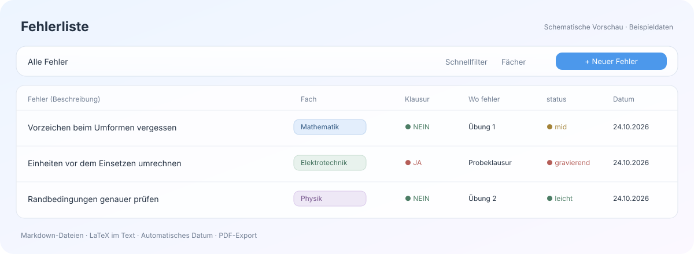

# Fehlerliste für Obsidian

Eine übersichtliche Fehlerdatenbank fürs Studium – mit farbigen Fächern, Formeln im Fließtext und einer schlichten Glasoptik. Alle Einträge sind normale Markdown-Dateien in deinem eigenen Vault.



**[Starter-Vault herunterladen](https://github.com/Ninyago53/obsidian-fehlerliste/releases/latest/download/Fehlerliste-Starter-Vault.zip)** · **[Nur das Plugin](https://github.com/Ninyago53/obsidian-fehlerliste/releases/latest/download/Fehlerliste-Plugin.zip)** · **[Installationsanleitung](docs/INSTALLATION.md)**

## In wenigen Minuten starten

1. **Starter-Vault** herunterladen und entpacken.
2. In Obsidian **Anderen Vault öffnen → Ordner als Vault öffnen** wählen und den entpackten Ordner **Fehlerliste** auswählen.
3. Unter **Einstellungen → Externe Erweiterungen / Community plugins** Community-Erweiterungen erlauben und **Fehlerliste** einschalten. Obsidian verlangt diese bewusste Freigabe; das Paket aktiviert fremden Code nicht still im Hintergrund.
4. **Fehlerliste – Start** öffnen und auf **Fehlerliste öffnen** klicken. Über **Neuer Fehler** den ersten Eintrag anlegen.

Obsidian muss bereits installiert sein. Für den Starter-Vault sind weder ein Terminal noch Git, Node.js oder Python nötig. Der Download enthält **keine persönlichen Fehlereinträge**.

## Du hast schon einen Vault?

Lade **Fehlerliste-Plugin.zip** herunter. Kopiere den darin enthaltenen Ordner **fehlerliste-notion-farben** direkt nach `<dein Vault>/.obsidian/plugins/`. Danach Obsidian neu starten, das Plugin aktivieren und den Einrichtungsdialog bestätigen. Alternativ: **Cmd/Ctrl+P → Fehlerliste: Fehlerliste einrichten**.

Der Assistent ergänzt fehlende Ordner, Tabelle und Vorlage. Bestehende Dateien bleiben erhalten. Die genaue Ordnerstruktur und eine bebilderte Strukturübersicht stehen in der [Anleitung](docs/INSTALLATION.md).

## Funktionen

| Bereich | Was du bekommst |
| --- | --- |
| Eine Tabelle | Fehlerbeschreibung, Fach, Klausur, Fundstelle, Schwere und Datum |
| Fächer | Hinzufügen, Farben automatisch vergeben, aus der Auswahl entfernen und wiederherstellen |
| Auswahlfelder | Farbige Optionen für Fach, Klausur und Schwere; Freitext ohne Vorschlagsbox |
| Datum | Lokales Tagesdatum bei neuen Einträgen im Fehlerordner; vorhandene Datumswerte bleiben erhalten |
| LaTeX | `Es gilt $$\frac{1}{k^3}$$ für große k.` wird als Satz mit Formel angezeigt |
| Filtern | Schnellfilter für Fach/Klausur und die normalen Bases-Filter |
| PDF | Export der geöffneten Tabelle mit ihrer aktuellen Sortierung und ihren Filtern |
| Bedienung | Einträge über einen Papierkorb entfernen, Bestätigung vor dem Löschen; begrenzter Rückgängig-Verlauf während der Sitzung |
| Darstellung | Zurückhaltende Farben, Glasflächen, helle/dunkle Oberfläche und anpassbare Spalten |

**Hinweis zur Bezeichnung „status“:** Gemeint ist die Schwere des Fehlers: **gravierend / mid / leicht**. Das ist kein Bearbeitungsfortschritt.

## Voraussetzungen und Grenzen

- **Obsidian Desktop ab 1.14.4**. Die Integration wurde für diese Version entwickelt; Teile der Tabellen- und PDF-Anbindung verwenden interne Obsidian-Schnittstellen. Spätere Obsidian-Updates können Anpassungen erfordern.
- Die Ausgangsversion wurde auf macOS verwendet. Windows/Linux und die neue Ersteinrichtung sind bisher automatisiert bzw. isoliert geprüft, nicht vollständig auf jedem System visuell getestet. Mobilgeräte werden nicht unterstützt.
- Die Erweiterung ist **noch nicht im offiziellen Community-Verzeichnis**. Die Installation erfolgt über diese GitHub-Downloads.
- Der Fehlerordner heißt intern **Fehlerliste-Notion**. Für die automatische Zuordnung diesen Namen beibehalten.
- LaTeX nutzt Obsidian/MathJax für mathematische Ausdrücke, keinen vollständigen TeX-Dokumentcompiler. Außerhalb der Bearbeitung erscheint die Formel; beim Anklicken der Quelltext.
- Entfernte Fächer werden aus der Auswahl genommen. Die Zuordnung bereits gespeicherter Fehler bleibt erhalten.
- Der PDF-Export nutzt die Desktop-Druckschnittstelle und speichert in Downloads. Vor großen Änderungen eine Vault-Sicherung anlegen; Rückgängig ersetzt kein Backup.

## Lokal und nachvollziehbar

Kein Konto für das Plugin, keine API-Schlüssel und keine eingebauten Analyse- oder Netzwerkaufrufe. Das Plugin erstellt und bearbeitet Dateien in deinem Vault; beim PDF-Export schreibt es eine PDF in deinen Downloads-Ordner. Obsidian-Plugins haben technisch weitreichenden lokalen Zugriff. Du kannst den gesamten Code in [main.js](main.js) lesen. [Datenschutz und Berechtigungen](docs/PRIVACY.md).

Die Glasoptik ist innerhalb von Obsidian gestaltet. Dieses Projekt ist unabhängig von Obsidian, Notion und Apple.

## Entwicklung und eigene Downloads

Voraussetzungen nur für die Entwicklung: Node.js 22+ und Python 3.10+.

```sh
npm test
npm run build
```

Es werden keine npm-Pakete benötigt. `main.js` ist zugleich der lesbare Plugin-Quelltext. Der Build prüft die Syntax und erstellt in `dist/` ein Plugin-Paket, einen sauberen Starter-Vault und SHA-256-Prüfsummen. Die Release-Automation veröffentlicht dieselben Dateien bei einem Versions-Tag.

Details: [Entwicklung und Veröffentlichungen](docs/DEVELOPMENT.md). Fehler oder Wünsche bitte über [Issues](https://github.com/Ninyago53/obsidian-fehlerliste/issues) melden, möglichst ohne persönliche Notizinhalte.

## Lizenz

[MIT](LICENSE) – du darfst die Erweiterung verwenden, verändern und weitergeben.
